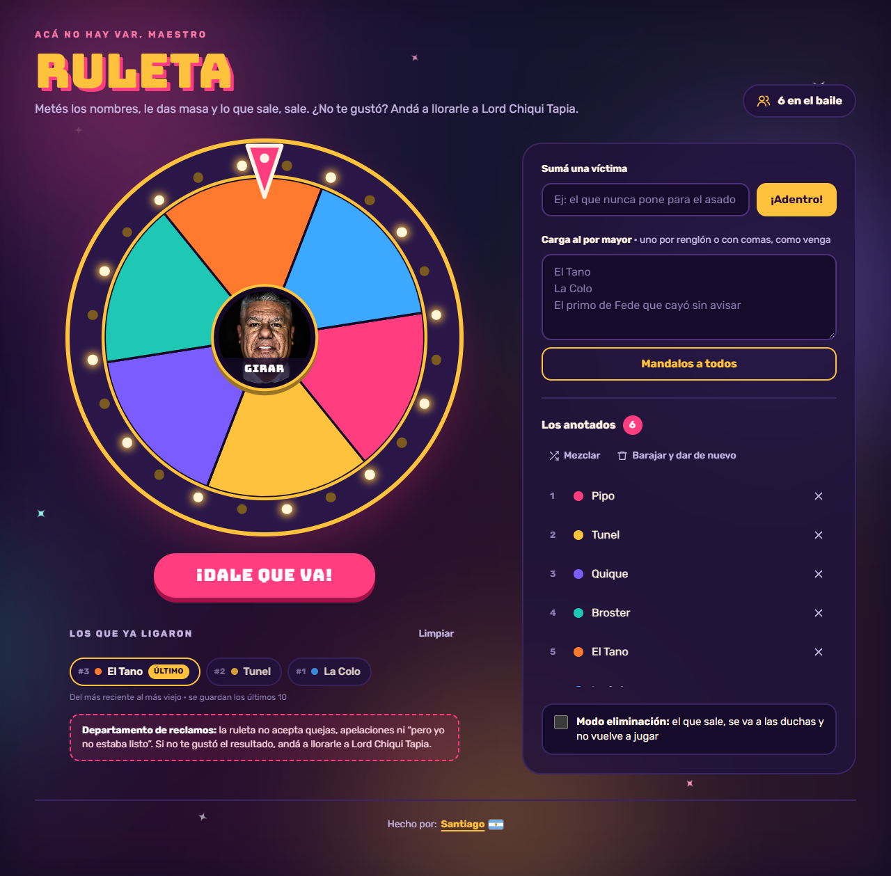

<div align="center">

# 🎡 Ruleta

**Acá no hay VAR, maestro.**
Metés los nombres, le das masa y lo que sale, sale. Ideal para sortear quién paga, quién lava los platos o a quién le toca.


### 👉 [Probala acá: rulapp.vercel.app](https://rulapp.vercel.app/)



</div>

---

## ✨ Funcionalidades

- 🎡 **Pinta de feria de noche.** Aro con 24 lamparitas que titilan (más rápido mientras gira), brillos de fondo y destellos.
- 🎯 **Giro con suspenso.** Frena suave hasta caer en un gajo. Se gira con el botón del centro de la rueda o con el botón rosa grande. Hacen falta al menos dos anotados.
- 📝 **Anotar gente.** De a uno en "Sumá una víctima" (con Enter o "¡Adentro!"), o varios juntos en "Carga al por mayor", uno por renglón o separados por comas.
- 🔀 **Acomodar la lista.** "Mezclar" cambia el orden, la ✕ saca a uno y "Barajar y dar de nuevo" vacía todo.
- 🏆 **Cartel del ganador.** Aparece sobre la rueda. Elegís "Que siga la joda" o "Afuera, ya fue". Con el **modo eliminación** activado, el que sale se va a las duchas igual.
- 🕘 **Los que ya ligaron.** Historial con los últimos 10 resultados.
- 🎨 **Tweaks.** Color principal (dorado, turquesa, celeste o naranja) y duración del giro (de 2 a 10 segundos).
- 💾 **Se guarda sola.** La lista, el historial y los ajustes quedan guardados en tu navegador, aunque recargues, cierres la pestaña o apagues la compu.
- ♿ **Accesible.** Se puede usar con teclado, con foco visible, y respeta la opción del sistema de reducir movimiento.
- 📱 **Responsive.** Funciona en el celular y en la compu.

### 📸 Foto del botón central

El botón del centro de la rueda usa de fondo la imagen `public/boton-centro.png`. Para cambiarla, reemplazá ese archivo por otro con el mismo nombre. Queda mejor una foto vertical o cuadrada con la cara centrada un poco arriba.

## 🚀 Cómo usarla

Necesitás tener instalado [Node.js](https://nodejs.org/) 20 o superior.

```bash
# 1. Clonar el repo
git clone https://github.com/Santipaul38/RulaApp.git
cd RulaApp

# 2. Instalar dependencias
npm install

# 3. Levantar el servidor de desarrollo
npm run dev
```

Después abrí la dirección que aparece en la terminal (por defecto, `http://localhost:5173`).

Para usar otro puerto:

```bash
npm run dev -- --port 8008
```

## 🌐 Publicarla

Antes de compilar para publicar, poné la URL definitiva en el archivo `.env`, sin barra al final:

```bash
VITE_SITE_URL=https://tu-ruleta.vercel.app
```

Con esa URL, `npm run build` completa la vista previa para compartir (WhatsApp, redes), los datos para Google y genera `robots.txt` y `sitemap.xml` en `dist/`.

## 📜 Scripts

| Comando           | Qué hace                                        |
| ----------------- | ----------------------------------------------- |
| `npm run dev`     | Levanta el servidor de desarrollo con recarga en vivo |
| `npm run build`   | Genera la versión de producción en `dist/`      |
| `npm run preview` | Sirve localmente la versión ya compilada        |
| `npm run lint`    | Revisa el código con Oxlint                     |

## 🗂️ Estructura

```
src/
├── App.jsx              # Página principal: panel, giro, historial, cartel del ganador y Tweaks
├── Wheel.jsx            # Rueda en SVG: gajos, aro con lamparitas, puntero y botón central
├── Background.jsx       # Fondo animado: manchas de luz, degradé y destellos
├── usePersistentState.js # Hook que guarda el estado en localStorage
├── main.jsx             # Punto de entrada de React
└── index.css            # Tailwind, paleta de colores, tipografías y animaciones
```

## 🛠️ ¿Cómo funciona?

- **El giro.** Al tocar *¡Girar!* se elige un ganador al azar y se calcula cuánto tiene que rotar la ruleta (varias vueltas completas más lo justo) para que ese valor quede bajo la flecha. La animación es una transición de CSS.
- **El guardado.** El hook `usePersistentState` funciona como `useState`, pero además guarda el valor en `localStorage`. Los datos quedan en ese navegador hasta que se borren los datos del sitio, y no se comparten entre dispositivos.

---

<div align="center">
Lo que sale, sale. Los reclamos, a Lord Chiqui Tapia. 🧉
</div>
